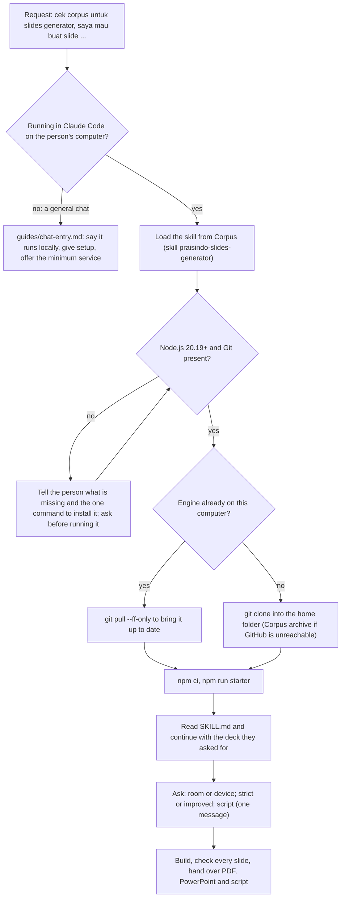

# Getting started from nothing

How an agent handles a first request from someone who has set nothing up, for example:

> Halo, tolong cek corpus untuk slides generator. Saya mau buat slide tentang ...

> Fetch corpus for the slides generator skills. I need a deck for ...

The person should not have to know about Node.js, Git, the repository or the plugin. The agent
finds the generator, sets it up, and then makes the deck they asked for, in the same conversation.
The same procedure is in Corpus as the skill `praisindo-slides-generator` (COR-2014); the
repository is public at
[github.com/Praisindo-Product/Praisindo-Slides-Generator](https://github.com/Praisindo-Product/Praisindo-Slides-Generator).



## 1. Find the generator's instructions

- With the Praisindo connector (Corpus): load the skill with `skill.get` name
  `praisindo-slides-generator` (COR-2014). Searching Corpus with the person's whole sentence may find
  nothing; search `slides generator` or list skills with `slide`.
- Without the connector, but with the web: the repository README and this guide.
- Do not start writing slides before the engine is set up; nothing made without it is in the house
  style.

## 2. Where you are running

- **Claude Code on the person's computer**, or Claude Code on the web with this repository: carry on.
- **A general chat** (Claude on the web, desktop or mobile, or another assistant): follow
  `guides/chat-entry.md` (Corpus COR-2016). Do not try to install the generator in a chat sandbox.

## 3. Check what is installed

Run, and read the result before going on:

```
node --version
git --version
```

- **Node.js** must be 20.19 or later (22 LTS recommended). **Git** any recent version.
- If either is missing, tell the person in their language what is missing and give the one command
  for their system. Ask before you run an installer; never install silently.

| System | Node.js 22 LTS | Git |
| --- | --- | --- |
| Windows | `winget install OpenJS.NodeJS.LTS` | `winget install Git.Git` |
| macOS | `brew install node@22` | `brew install git` (or Xcode command line tools) |
| Linux | the distribution's package or nodejs.org | `apt install git` or equivalent |

After installing on Windows, a new terminal may be needed before `node` is found; say so if the
check still fails.

## 4. Get the engine, or update it

ENGINE is the folder that holds `engine/build.mjs` and `skills/praisindo-slides-generator/SKILL.md`.

1. **Already here?** Look in the current folder, then `~/Praisindo-Slides-Generator`. If the Claude
   Code plugin `praisindo-slides-generator` is installed, its folder is ENGINE.
2. **Present: update it.** In a clone, `git -C ENGINE pull --ff-only` so the person gets the
   current version. If the pull fails because of local changes, leave them alone and say so; build
   with what is there. For the plugin: `claude plugin marketplace update praisindo`, then
   `claude plugin update praisindo-slides-generator@praisindo`.
3. **Not present: clone it** into the person's home folder (ask first if they want another place):
   ```
   git clone https://github.com/Praisindo-Product/Praisindo-Slides-Generator.git ~/Praisindo-Slides-Generator
   ```
   The repository is public; no GitHub account is needed.
4. **GitHub unreachable:** download the newest `praisindo-slides-generator-<version>.tar.gz` from
   Corpus, "Praisindo Slides Generator: engine package" (COR-2009), with `corpus.attachments`, and
   unpack it into the home folder (Windows Git Bash: `tar --force-local -xzf <file>`).

Then install the packages and check the build:

```
cd ENGINE && npm ci && npm run starter
```

`npm run starter` must write `decks/starter/output/Praisindo-Starter.pdf`. If it fails, read the
error, fix what it names (usually a missing Node.js version or an interrupted install: run `npm ci`
again), and do not go on until it passes.

Tell the person in one or two sentences where the generator now lives and that it is ready.

## 5. Make the deck they asked for

Do not stop at "it is installed" and make them ask again. Read `ENGINE/skills/praisindo-slides-generator/SKILL.md`
and follow it with the request they already gave:

1. Ask, in one message, only what the request does not answer: room or device; strictly by a
   reference or improved upon it; a speaker script; and only if unclear the audience, the decision
   sought, the time slot, the language and the client.
2. Make the deck as `ENGINE/decks/<name>/deck.tsx`, build it, look at every contact sheet, fix,
   build with `--pptx`.
3. Hand over the paths of the PDF, the PowerPoint file and the script, with what changed, what moved
   to the appendix, what needs confirming and what is illustrative.

If the person attached a file (a deck, a document), use it as the source; if they named a client
not in the registry, follow `guides/clients.md`.

## 6. Keep client work private

This repository is **public**. A client deck usually is not.

- Never commit or push a client deck, its logos or its outputs to the repository unless the person
  says in so many words that it may be public. Output folders are already ignored by git; the deck
  source and its assets are not.
- Do not push anything to GitHub as part of making a deck. Changing the generator itself is a
  separate piece of work.

## 7. Next time

The person can ask directly in Claude Code, from any folder: "buatkan deck untuk ...". The agent
finds ENGINE as in step 4, updates it, and goes straight to step 5.
